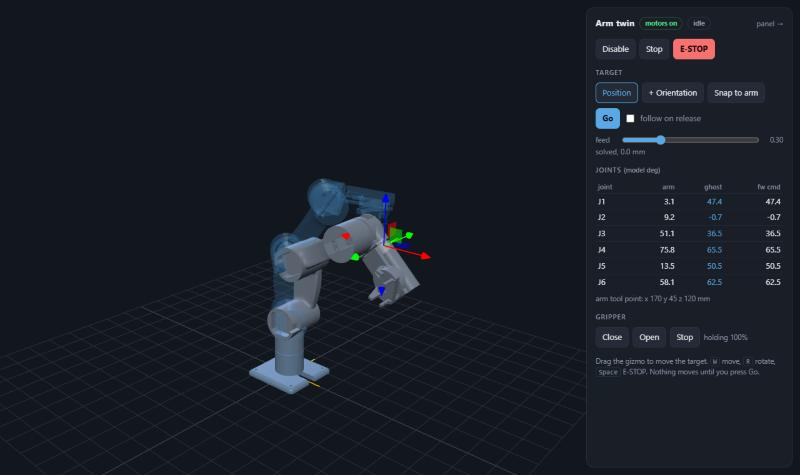
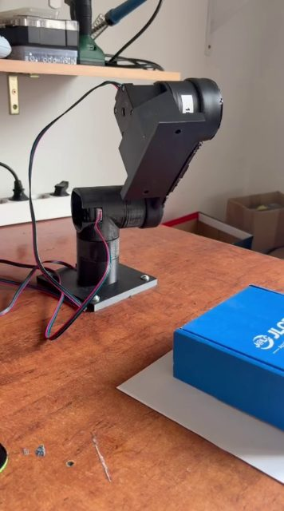
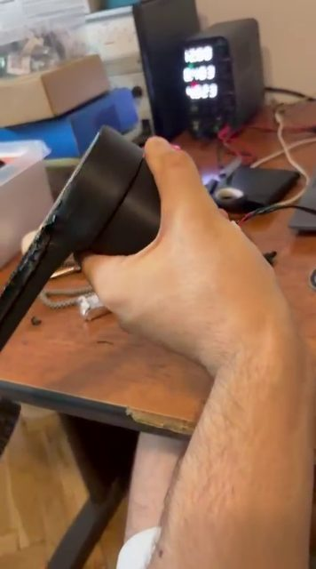

# Six-Axis Robot Arm

A six-axis arm built from scratch around 3D-printed cycloidal gearboxes. This
repo has everything: the gearbox generator for Fusion 360, print files,
ESP32 firmware, a browser control panel with a 3D digital twin and 6-DOF IK,
the wiring schematic, and the September vision experiments.



| [](media/2026-09-02-vision-reach-blue-box.mp4) | [](media/2026-09-02-gearbox-test.mp4) |
|---|---|
| Overhead camera + 3-DOF IK reaching for a box (Sept 2026) | Testing an inverted cycloidal gearbox |

More video and the story behind it: [samerhaddadin.me/work/robotic-arm](https://samerhaddadin.me/work/robotic-arm).

## The arm

| | |
|---|---|
| Axes | J1 base yaw, J2 shoulder, J3 elbow, J4 wrist pitch, J5 wrist roll, J6 wrist pitch, plus a tendon hand |
| J1-J3 | NEMA 17 (17HS4401S) + TMC2209 over UART, through printed **inverted cycloidal** boxes: **16:1, 21:1, 16:1** |
| J4-J6 | MG996R / MG995, 270° hobby servos |
| Hand | one continuous-rotation MG995 winding the tendons |
| Links | J2→J3 130 mm, J3→J4 130 mm |
| Controller | ESP32-WROOM-32, USB serial to a PC |
| Camera | Luxonis OAK-D SR, overhead (used by the vision pipeline) |

The gearbox housings are part of the links. Each joint's motor and pin carrier
sit in one link, and its roller drum is printed into the next. Because the
drum is the part that turns, the ratio is the **roller count**, and the drum
turns the same way as the motor. See [docs/gearbox.md](docs/gearbox.md).

## Status

- **Works:** all six joints move. Firmware 1.3.0 drives them, and the panel and
  twin control them. IK reaches arbitrary poses in the twin.
- **Fixed in this release, not yet checked on the arm:** gear ratios (the
  firmware used 15/20/15), the gripper's open/close logic, and the 21-roller
  disc B, which interferes with its ring in the CAD.
  [docs/calibration.md](docs/calibration.md) is the 20-minute checklist.
- **Next:** teleoperation from a Quest 3, then learning from demonstrations.
  See the [roadmap](docs/roadmap.md).

## Quick start

```bash
# firmware (PlatformIO)
cd firmware && pio run -t upload

# panel + twin, with or without the arm plugged in
pip install pyserial numpy
python host/control.py              # or: --simulate
# open the printed URL, then "3D twin"
```

The gearbox generator: [hardware/gearbox-generator](hardware/gearbox-generator).
The wiring: [docs/wiring.md](docs/wiring.md).

## Repository map

| Folder | |
|---|---|
| [`firmware/`](firmware) | `arm-fw`: ESP32 joint controller, PlatformIO |
| [`host/`](host) | `armlink` Python driver, kinematics, simulator, control panel, 3D twin |
| [`description/`](description) | `arm.json`, link meshes from the CAD, generated URDF |
| [`hardware/gearbox-generator/`](hardware/gearbox-generator) | Fusion 360 cycloidal joint generator v7 (+ the v6 scripts) |
| [`hardware/stl/`](hardware/stl) | print files: arm links (`Body 1-7`) and gearbox parts |
| [`hardware/electronics/wiring/`](hardware/electronics/wiring) | as-built wiring schematic (KiCad 9, PDF) |
| [`hardware/electronics/can-stepper-node/`](hardware/electronics/can-stepper-node) | unfinished per-joint CAN driver board (ESP32-C3, TMC2209, MT6701) |
| [`hardware/calculators/`](hardware/calculators) | sizing spreadsheets |
| [`ros2/`](ros2) | September 3-DOF vision pipeline, ROS 2 Jazzy on WSL (legacy) |
| [`docs/`](docs) | calibration, wiring, gearbox notes, roadmap |
| [`archive/`](archive) | the first 3-DOF test rig firmware and superseded prints |

`Body N` in `hardware/stl/arm` is the Fusion body name: 1 base, 2 turret
(J1 drum + J2 motor), 3 upper arm (J2 + J3 drums), 4 forearm (J3 motor + J4
servo), 5-7 wrist.

## License

- Software (`firmware/`, `host/`, `ros2/`, `description/tools/`, generator
  scripts): [MIT](LICENSE)
- Hardware (CAD, STL, KiCad, `description/` meshes):
  [CERN-OHL-P-2.0](LICENSE-HARDWARE)

The hand on the end is a third-party design and is not part of this repo.

Built by [Samer Haddadin](https://samerhaddadin.me).
