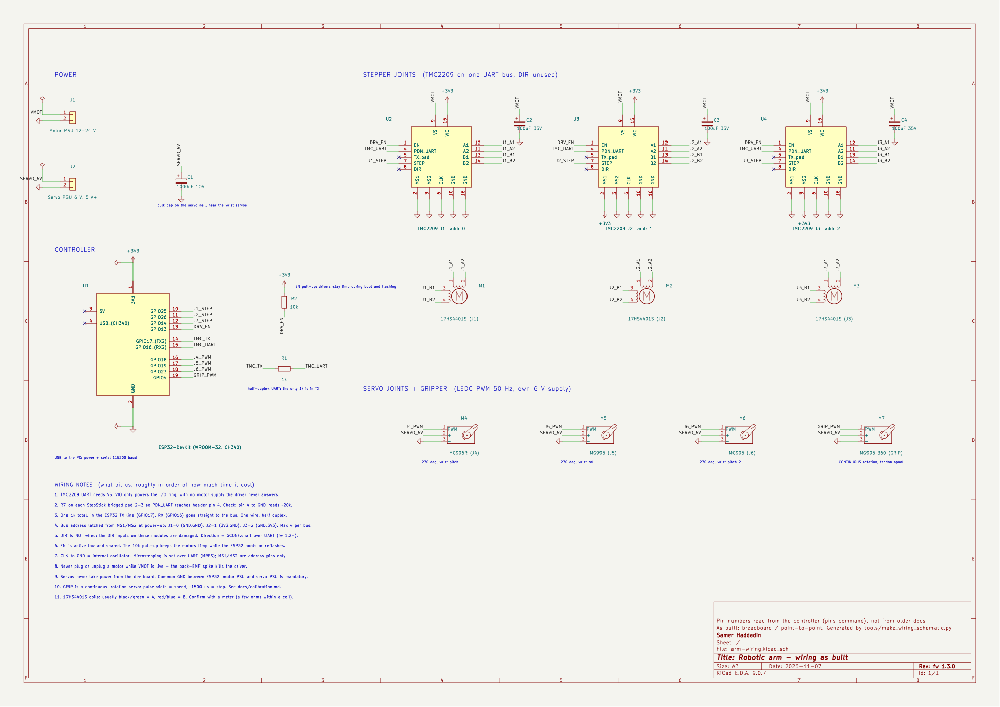

# Wiring (as built)

Schematic: [`hardware/electronics/wiring/arm-wiring.pdf`](../hardware/electronics/wiring/arm-wiring.pdf)
(KiCad 9 source next to it; ERC clean, regenerated from one pin table by
`tools/make_wiring_schematic.py`).

The pins below were read from the controller itself (`pins`, 2026-11-07).
Older docs in `archive/` disagree with each other; this table wins.

| Signal | ESP32 GPIO | Goes to |
|---|---|---|
| J1 STEP | 25 | TMC2209 addr 0 |
| J2 STEP | 26 | TMC2209 addr 1 |
| J3 STEP | 14 | TMC2209 addr 2 |
| Driver EN (active low, shared, 10k pull-up) | 13 | all three EN |
| TMC UART TX (through 1k) | 17 | PDN_UART bus |
| TMC UART RX | 16 | PDN_UART bus |
| J4 PWM (MG996R, 270°) | 18 | wrist pitch |
| J5 PWM (MG995, 270°) | 19 | wrist roll |
| J6 PWM (MG995, 270°) | 23 | wrist pitch 2 |
| GRIP PWM (MG995 continuous) | 4 | hand spool |

DIR is not wired. The modules' DIR inputs are damaged, so direction goes
over UART as the TMC2209 `GCONF.shaft` bit. See
[notes/direction-over-uart.md](notes/direction-over-uart.md) for how and why.

## Power

- Motor supply 12-24 V to every driver's VS, with a 100 µF electrolytic per driver.
- Servo supply 6 V, at least 5 A, with about 1000 µF on the rail. Never from the dev board.
- ESP32 from USB. **One common ground** between the ESP32, the motor supply and the servo supply.

## The traps

The schematic's notes block lists all eleven. The three that cost the most
time: a TMC2209 will not answer on UART without VS powered, solder jumper R7
has to be bridged pad 2-3 on each module, and there is exactly one 1k
resistor, in the TX line.
