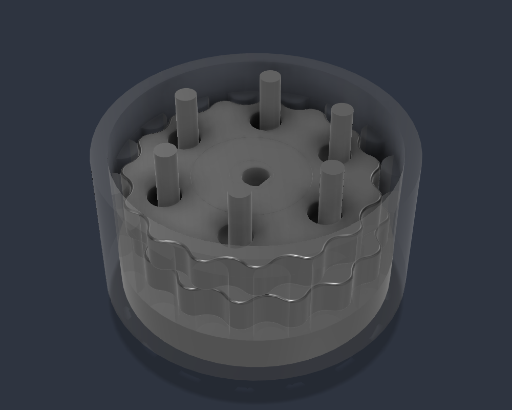

# Cycloidal joint generator (Fusion 360)

One dialog, one complete joint: the roller drum that becomes part of your
link, the motor-side carrier your NEMA motor bolts to, both cycloidal discs,
the eccentric, and reference bearings, screws and motor so you can see the
fits. You only join the drum to whatever you are building.



## Install and run

1. Fusion: **Utilities > Add-Ins > Scripts and Add-Ins**, click **+** next to
   *My Scripts*, choose the [`CycloidalJoint`](CycloidalJoint) folder.
2. Open a design (an empty one, or the arm), select **CycloidalJoint**, **Run**.
3. Pick the ratio, bearings, motor and screws. The box at the bottom updates
   live with the derived geometry, the screw length to buy, and anything that
   will not work. **Generate** is disabled until it would.

Each run adds a new component, so one design can hold every joint of an arm.

## What it builds: the inverted layout

```
 two bearings (default)

   far carrier ─┐                                ┌─ motor-side carrier ── NEMA motor
                │  [bearing][disc A][disc B][bearing]  │
   screw heads ─┘   ───────── output screws ───────────┘ threaded in
                   └───────────── DRUM (turns) ───────┘
```

The carriers and the six output screws make one rigid cage bolted to the
motor. The **drum** holds the rollers and the big bearings' outer races, and it
is the part that turns. Join your link to it.

**The ratio is the roller count.** With the discs held against rotation by the
screws, one motor turn walks the drum by one roller pitch, so a drum with 16
rollers is 16:1 and turns **the same way** as the motor. The classic layout
(fixed ring, screws as output) gives `rollers - 1` and turns backwards. That is
why the arm's "15:1" and "20:1" boxes are really 16:1 and 21:1: the firmware
used the wrong numbers until 1.3.0.

| Body | Print? | Notes |
|---|---|---|
| Drum (output) | yes | roller ring + bearing seats. Join your link here |
| Carrier - motor side | yes | motor bolts on from inside (counterbored), screws thread in |
| Carrier - far side | yes | two-bearing version: screw heads sit on it |
| Disc A, Disc B | yes | half a lobe apart (see below) |
| Eccentric | yes | two offset journals on the motor's D-cut |
| Link ... | yes | optional, join it to both drums |
| REF ... | **no** | bearings, screws, motor at nominal size, tinted steel |

**One bearing** is shorter and cheaper, but the drum hangs off a single
bearing. That cantilever is what made the early arm wobble. Use two.

## Fits you tune without re-running

Modify > Change Parameters. Shared by every joint in the design, because
they describe your printer, not the gearbox:

| Parameter | Default | Fit |
|---|---|---|
| `cj_tol_disc_bore` | 0.10 | disc bore over the cam bearing OD |
| `cj_tol_journal` | 0.04 | eccentric journal under the cam bearing bore |
| `cj_tol_big_seat` | 0.08 | drum seat over the big bearing OD |
| `cj_tol_carrier` | 0.05 | carrier journal under the big bearing bore |
| `cj_tol_motor_bore` | 0.25 | eccentric bore over the motor shaft |
| `cj_tol_out_hole` | 0.25 | disc output holes, on top of screw + 2E |

The **profile clearance** is in the dialog instead. It shapes every point of
the disc spline, so it needs a re-run.

## Two v6 bugs that v7 fixes

**Disc B with an odd roller count.** v6 drew disc B as disc A turned 180°.
Relative to the ring, the second disc has to be turned back by *half a lobe*,
and a 180° turn only lands there when the roller count is even. With 21
rollers (the arm's shoulder box) disc B overlaps the ring by **185 mm³** in the
Fusion model. That disc has to bind or flex in every revolution. v7 places
it correctly for any count: `python cyclo_core.py` ends with a mesh check
showing both discs clearing every roller by exactly the profile clearance for
11 to 25 rollers.

**The eccentric could not be assembled.** v6 joined a concentric spacer to the
offset journals. A cam bearing slides on along the shaft, and a round spacer of
7.08 mm stands 0.56 mm outside an 8 mm journal offset by 1.02 mm, so the
bearing cannot pass it. v7's eccentric is just the two journals: each cam
bearing goes on from its own end.

## Check the maths without Fusion

```bash
python hardware/gearbox-generator/CycloidalJoint/cyclo_core.py
```

Prints the derived geometry and checks for five configurations (16:1, 21:1,
one bearing, NEMA 23, a small NEMA 14 joint), including the ones it refuses.

## Files

| | |
|---|---|
| `CycloidalJoint/CycloidalJoint.py` | the dialog |
| `CycloidalJoint/cyclo_core.py` | presets, derived geometry, validation, disc profile. No Fusion |
| `CycloidalJoint/cyclo_build.py` | draws a plan in Fusion |
| `legacy-v6/` | the previous script-constants generators (classic layout), kept for reference |
